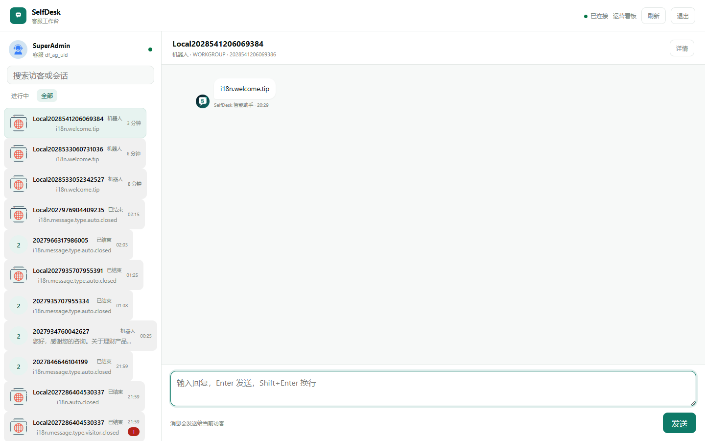
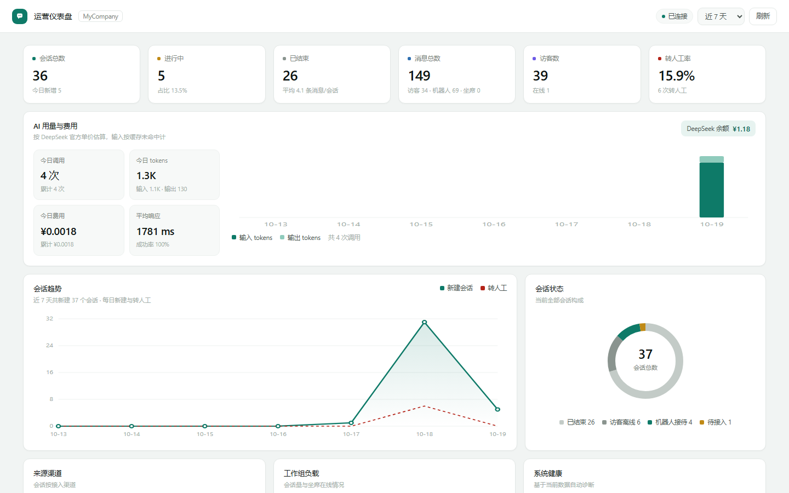
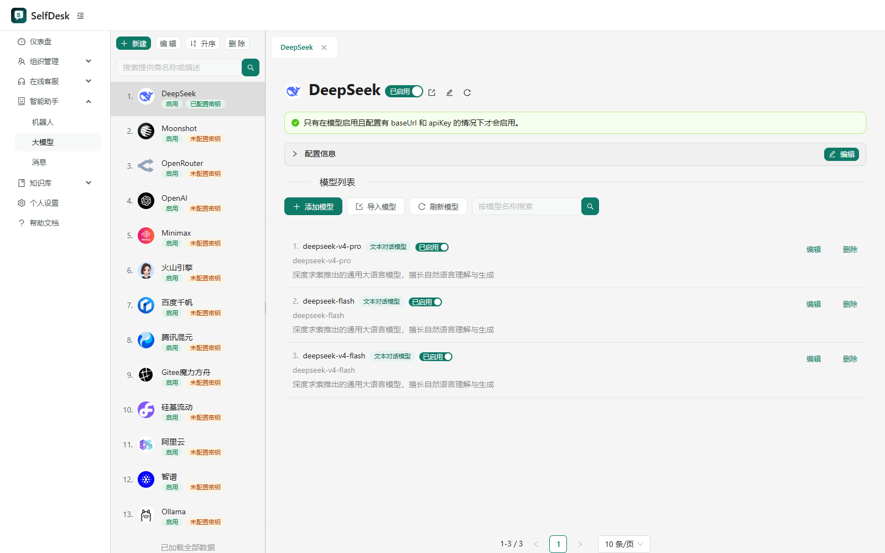

# SelfDesk · 客服系统界面与部署层


> **完整源码在 [selfdesk-platform](https://github.com/wms3643/selfdesk-platform)**：24 个模块、239 个控制器的整套系统。
> 本仓库只保留界面与部署脚本，适合单独看这部分实现。

SelfDesk 客服系统的**界面与部署层**：自写客服工作台、运营仪表盘、统一视觉层，配一套能重复执行的打包与启停脚本。

AI 侧用 **Spring AI**，模型可配多厂商，也能一键切到本地 Python 编排层（见 [docs/SPRING-AI.md](docs/SPRING-AI.md)）。



> 本仓库不含业务工程源码与构建产物（jar）；需配合完整源码工程构建。许可见 [LICENSE](LICENSE) 与 [NOTICE.md](NOTICE.md)（AGPL-3.0）。

---

## 两个版本

同一套客服产品，两种 AI 实现。**入口、页面、业务逻辑都一样，换的是 AI 引擎。**

| | 版本 A · 全 Java | 版本 B · 双语言 |
|---|---|---|
| 业务系统 | Java / Spring Boot | 同一套，不改 |
| AI 实现 | Spring AI + DeepSeek | Python + LangGraph 编排 |
| 进程数 | 1 个（:9003） | 2 个（:9003 业务 + :8003 AI） |
| 会话与状态 | 全在 PostgreSQL | 业务在 PostgreSQL，AI 状态在另一个 PostgreSQL 库 |
| 访客入口 | `:9003/chat/` | **同一个** `:9003/chat/`，AI 请求转给 8003 |
| 代码仓库 | 本仓库 | 本仓库 + [selfdesk-langgraph](https://github.com/wms3643/selfdesk-langgraph) |

版本之间切换只改一个环境变量（`SPRING_AI_DEEPSEEK_BASE_URL`），业务代码零改动：

```
.\scripts\ai-gateway.ps1 on -Restart     # A → B
.\scripts\ai-gateway.ps1 off -Restart    # B → A
```

## 它解决什么

系统自带完整的客服业务，但有三件事不覆盖，这一层就是补它们：

| 缺口 | 这一层的做法 |
|---|---|
| 坐席工作台只有默认界面 | 用原生 HTML/CSS/JS 重写一版，信息密度更高、交互更直接 |
| 运营数据分散在多个接口，看不到 AI 成本 | 独立仪表盘聚合会话、状态、token 与费用 |
| 后台是 AntD 默认蓝，和项目其他前端不统一 | 运行时注入一套设计 token，不改业务代码 |

## 界面

| 页面 | 地址 | 来源 |
|---|---|---|
| 访客端 | `http://127.0.0.1:9003/chat/` | 系统自带，套统一主题 |
| 客服工作台 | `http://127.0.0.1:9003/console/` | **本仓库** |
| 运营仪表盘 | `http://127.0.0.1:8002/` | **本仓库** |
| 管理后台 | `http://127.0.0.1:9003/admin` | 系统 + 主题层 |
| 坐席移动端 | `http://127.0.0.1:9003/agent/` | 系统自带 |





## 快速开始

前置：

| 依赖 | 版本 | 用途 |
|---|---|---|
| JDK | 21 | 运行系统 |
| Maven | 3.9+ | 构建系统 |
| Docker | 任意近期版本 | 跑 Elasticsearch（必需） |
| Python | 3.10+ | 打包脚本、仪表盘、向量服务 |
| DeepSeek Key | — | Spring AI 调用模型 |

```powershell
# 1. 取仓库
git clone https://github.com/wms3643/selfdesk-springai.git
cd selfdesk-springai

# 2. 本地配置（不会提交）
copy .env.example .env.local
#   填 DEEPSEEK_API_KEY、BYTEDESK_ADMIN_PASSWORD

# 3. 构建系统 + 打补丁（首次约 5~15 分钟）
.\scripts\bootstrap.ps1

# 4. 起 Elasticsearch
docker compose up -d

# 5. 起服务（ES / Embedding / 应用 / 仪表盘）
.\scripts\selfdesk.ps1 start
```

打开 `http://127.0.0.1:9003/admin` 和 `http://127.0.0.1:8002/`。

> 向量服务需要 `pip install fastembed`。如果本机已有 OpenAI 兼容的 `/v1/embeddings`，
> 直接让它监听 8000 即可，`selfdesk.ps1` 会复用。
>
> 已经有构建好的 jar：`$env:SELFDESK_JAR="..."; .\scripts\bootstrap.ps1 -SkipBuild`。

### 可选：本机免密

```powershell
'{"username":"admin@email.com","password":"你的密码"}' > .selfdesk-autologin.json
.\scripts\bootstrap.ps1 -SkipBuild
```

凭据只进 jar，不进仓库（该文件已 gitignore）。

## 目录

```
console/            客服工作台（HTML + CSS + 原生 JS）
dashboard/          运营仪表盘（Python 标准库，无第三方依赖）
admin-patch/        注入后台的主题脚本与首页替换脚本
scripts/
├─ selfdesk.ps1     一键启停（ES / Redis / Embedding / App / Dashboard）
├─ bootstrap.ps1    构建系统 → 打补丁 → 给出下一步
├─ patch_jar.py     把界面层写进 fat jar（幂等）
├─ ai-gateway.ps1   Spring AI 在「直连模型」与「本地编排层」之间切换
└─ embedding_server.py  本地向量服务（fastembed）
docs/               架构、打包机制、排障、Spring AI 对接
compose.yaml        Elasticsearch（+ 可选 Redis）
```

## 文档

- [架构与取舍](docs/ARCHITECTURE.md)
- [打补丁机制与升级流程](docs/PATCHING.md)
- [故障排查](docs/TROUBLESHOOTING.md)
- [Spring AI 模型接入与网关切换](docs/SPRING-AI.md)

## 测试

```bash
pip install -r requirements-dev.txt
pytest        # 3 个用例，秒级完成，不需要业务 jar
```

| 用例 | 验证什么 |
|---|---|
| `test_patch_overwrites_and_injects` | console 被覆盖、brand.js 写入、`<script>` 注入、theme-color 改色、其他条目不动 |
| `test_backup_created` | 打补丁前生成 `.jar.bak-selfdesk` |
| `test_idempotent` | 连续打两次，`<script>` 仍只有一处 |

CI 里还会跑：脚本语法、密钥扫描、敏感文件、README 图片引用、compose 解析。

## 能跑到什么程度

**这不是 clone 就能直接运行的完整应用**，需要业务 jar 与 ES。诚实的验证范围：

| 验证项 | 状态 |
|---|---|
| `patch_jar.py` 覆盖页面、注入脚本、改 theme-color、保留其他条目 | 合成 jar 实测通过 |
| 重复执行幂等（brand.js 只注入一次） | 通过 |
| 无 `.selfdesk-autologin.json` 时不写入任何凭据 | 通过 |
| 四个 PowerShell 脚本语法解析 | 0 错误 |
| GitHub Actions：补丁测试 + 语法 + 密钥扫描 + 敏感文件 + 图片引用 | success |
| 完整启动（ES + 应用 + 仪表盘） | 依赖业务工程部署，需按上面步骤执行 |

前端三个页面的截图都来自本地真实运行。

## 已知限制

- **jar 补丁是覆盖式**：升级业务工程后必须重跑 `bootstrap.ps1`，否则界面层会被覆盖。
- **后台主题靠 CSS 覆盖**：AntD 结构变化时可能要补选择器。
- **仪表盘费用是估算**：按 DeepSeek 公开单价折算，不是账单。
- **免密只适合本机**：凭据在 jar 里，公网部署请删掉 `.selfdesk-autologin.json` 重新打包。
- **许可**：AGPL-3.0，详见 LICENSE 与 NOTICE.md。

## Roadmap

- [ ] `console/` 拆成模块（目前单文件），便于二次开发
- [ ] 仪表盘支持导出 CSV
- [ ] 用 Testcontainers 做一次端到端冒烟（业务工程 + ES）
